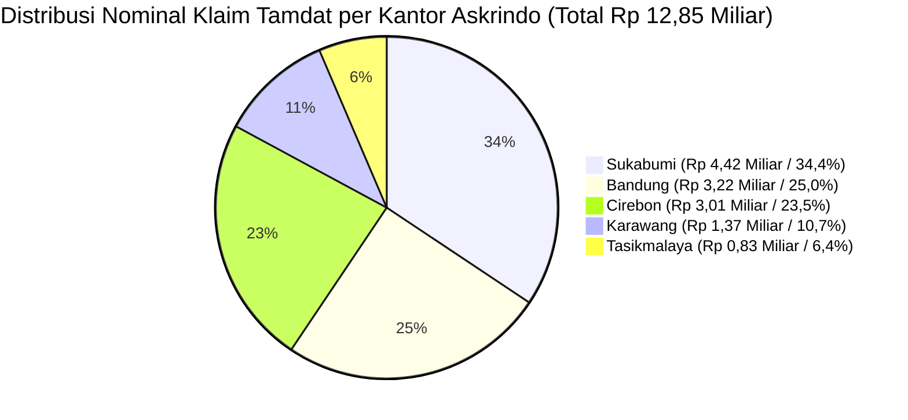
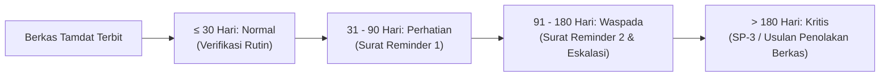

# Transformasi & Rekapitulasi Data Terupdate Dashboard Klaim Tamdat Askrindo – BRI Kanwil 2

## 1. Rekapitulasi Eksekutif Portofolio Klaim Tamdat Terupdate

Berdasarkan konsolidasi berkas data klaim tambahan (*tamdat*) terbaru pada **Kanwil 2 Jawa Barat**, seluruh data telah dinormalisasi dan diintegrasikan secara komprehensif:

### Tabel Konsolidasi Kantor Cabang Askrindo (Kanwil 2):

| Kantor Askrindo | Cakupan Unit BRI | Total Debitur | Total Nilai Tuntutan Klaim (Rp) | % Porsi Nominal | Prioritas Supervisi |
| :--- | :---: | :---: | :---: | :---: | :---: |
| **Kantor Askrindo Sukabumi** | 56 Unit | 275 Debitur | **Rp 4.415.337.543** | 34,37% | 🔴 Kritis (Volume Tertinggi) |
| **Kantor Askrindo Bandung** | 70 Unit | 140 Debitur | **Rp 3.218.597.965** | 25,05% | 🟠 Tinggi |
| **Kantor Askrindo Cirebon** | 42 Unit | 86 Debitur | **Rp 3.014.872.347** | 23,46% | 🟠 Tinggi (Nominal Per Debitur Besar) |
| **Kantor Askrindo Karawang** | 37 Unit | 58 Debitur | **Rp 1.374.389.927** | 10,70% | 🟡 Sedang |
| **Kantor Askrindo Tasikmalaya** | 37 Unit | 65 Debitur | **Rp 825.629.702** | 6,43% | 🟢 Terkendali |
| **TOTAL KANWIL 2 JAWA BARAT** | **242 Unit** | **624 Debitur** | **Rp 12.848.827.485** | **100,00%** | **SLA Monitoring Aktif** |

---

## 2. Top 10 Unit/Cabang BRI dengan Konsentrasi Klaim Terbesar (Pareto 80/20)

Penyelesaian klaim tamdat dapat dipercepat secara signifikan dengan memfokuskan rekonsiliasi berkas pada 10 unit/cabang berikut:

| Peringkat | Kantor Askrindo | Cabang / Unit Kerja BRI | Jml Debitur | Nilai Tuntutan Klaim (Rp) | Kendala Utama yang Sering Ditemukan |
| :---: | :--- | :--- | :---: | :---: | :--- |
| **1** | Cirebon | **BRI, CABANG CIREBON** | 3 | **Rp 1.369.302.984** | LKN Kunjungan 3x, Rekening Koran belum ada, SKU belum lengkap |
| **2** | Sukabumi | **BRI, UNIT CISOLOK CIBADAK** | 53 | **Rp 780.877.606** | SLIK OJK (bukti lunas kredit aktif), KTP tertukar, LKN belum TTD |
| **3** | Cirebon | **BRI, CABANG KUNINGAN** | 1 | **Rp 435.212.632** | LKN SP 1-3, Rekening Koran belum ada, legalitas NIB/SKU |
| **4** | Sukabumi | **BRI, UNIT CICURUG** | 23 | **Rp 436.778.028** | Surat lunas sebelum akad di bank lain, SKU <6 bulan, LKN anomali |
| **5** | Sukabumi | **BRI, UNIT PURABAYA SUKABUMI** | 25 | **Rp 426.650.328** | NPWP belum ada (>50 Jt), SLIK tertukar dengan nama orang lain |
| **6** | Sukabumi | **BRI, UNIT CITEPUS CIBADAK** | 23 | **Rp 370.061.493** | Rekening koran kosong/tidak ada, KTP tidak sesuai identitas |
| **7** | Bandung | **BRI, CABANG SOREANG** | 1 | **Rp 365.902.301** | SLIK belum digabung riwayat terbaru, SKU bukan a.n debitur |
| **8** | Bandung | **BRI, UNIT PUSAKARATU PAMANUKAN** | 7 | **Rp 282.267.716** | Mutasi Rekening Koran 6 bulan, SLIK saat pencairan |
| **9** | Bandung | **BRI, KCP TAMAN KOPO INDAH** | 1 | **Rp 204.394.006** | RC 6 bulan terakhir, LKN TTD bank/debitur, anomali inject KTP |
| **10** | Sukabumi | **BRI, KCP CIRANJANG** | 3 | **Rp 193.030.451** | NPWP belum ada, SLIK sebelum akad bukan an debitur |

---

## 3. Matriks Penuaan (Aging SLA) & Tindakan Hukum/Operasional

1. **Bucket ≤ 30 Hari (Hijau - Normal)**:
   - Tindakan: Sistem mengirimkan notifikasi digital daftar kekurangan berkas langsung ke email/PIC Mantri Unit BRI.
2. **Bucket 31 - 90 Hari (Kuning - Perhatian)**:
   - Tindakan: Penerbitan **Surat Reminder 1** dari Askrindo ke Pimpinan Cabang/Unit BRI tembusan Pincapem.
3. **Bucket 91 - 180 Hari (Oranye - Waspada)**:
   - Tindakan: Penerbitan **Surat Reminder 2** dengan batas waktu pemenuhan 14 hari kerja. Penghentian sementara proses klaim baru untuk unit bersangkutan jika tidak ada progres.
4. **Bucket > 180 Hari (Merah - Kritis / Risiko Kadaluwarsa)**:
   - Tindakan: Penerbitan **Surat Peringatan Terakhir (SP-3)**. Apabila dalam waktu 7 hari kerja dokumen susulan tidak dipenuhi atau tidak ada klarifikasi resmi, berkas klaim diusulkan untuk **Ditolak Berkas Kadaluwarsa** sesuai ketentuan PKS Penjaminan KUR.
